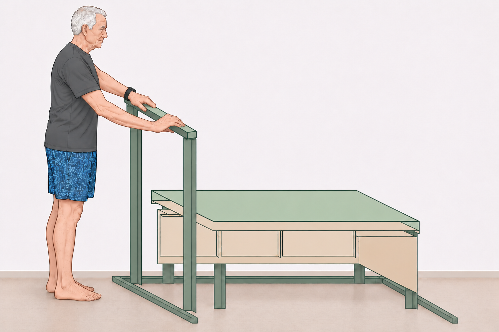

# Паспорт тренажёра

**Рабочие эскизы от 25 ноября 2026.** На 26 ноября автор сравнивает скамью с постоянным сиденьем и напольный шкаф со складным сиденьем. Обе компоновки вошли в основную ветку. Окончательная форма остаётся открытой. Для первой примерки здесь взята скамья – в её эскизе уже видны перекладина, стойки и сторона подхода. [Предварительное задание, с. 3–4](Preliminary_trainer_brief_A4_2026-11-25.pdf) · [Границы выбора, D-034](../DECISIONS.md#d-034--25112026)

## Что приняла автор

- Одним изделием по очереди пользуются дети, молодые взрослые и пожилые. В ранней консультации автор рассматривала молодого человека как главного героя. Позднее прямо подтвердила участие всех трёх групп. Возрастные границы и опоры для каждой ещё уточняются. [Консультация 03, 02:20–02:43](../../meetings/raw/teacher-discussion-03.md) · [Решение D-022 от 6 ноября](../DECISIONS.md#d-022--06112026)
- Монтаж без сверления. Автору понравилось вертикальное хранение. Для сравнения взят шкаф на собственном основании. В обоих эскизах предполагается передача усилия на пол. Устойчивость каждого предстоит проверить. [Референсы D-024](../DECISIONS.md#d-024--06112026) · [Решение D-025 от 6 ноября](../DECISIONS.md#d-025--06112026)
- К просмотру 25 декабря нужны одна рабочая идея, эскизы и черновой макет. Автор сообщила состав показа и срок. Отдельного документа кафедры с требованиями к материалу или масштабу макета в просмотренных материалах нет. Картон 1:1 здесь предложен для проверки хвата. [Решение D-039 от 26 ноября](../DECISIONS.md#d-039--26112026) · [План](../roadmap.md)

## С какими исходниками работать

| Компоновка | Редактируемая геометрия | Что видно на эскизе |
| --- | --- | --- |
| Скамья, 25 ноября | [Вид в три четверти, SVG](../../design/preliminary-trainer-2026-11-25/bench-concept.svg) | Одна поперечная перекладина на двух стойках у короткого торца, низкое постоянное сиденье, три отсека, открытый длинный край основания. |
| Напольный шкаф, 25 ноября | [Закрытый и раскрытый виды, SVG](../../design/preliminary-trainer-2026-11-25/cabinet-concept.svg) | Складное сиденье с двумя передними ножками, вертикальное хранение, собственное основание у стены. |

Размеры исходных объёмов заданы в [построении обеих схем](../../tools/build_visual_analogs_and_brief.py#L151). Самостоятельный CAD-файл изделия, фото натурного макета и протокол обмера в просмотренных материалах не найдены. Карандашные и маркерные листы 25–26 ноября сохранены в закрытых PR №10–12. Их можно использовать для обсуждения подачи. Основание для выбора компоновки остаётся в [решениях](../DECISIONS.md#d-034--25112026). [Указатель черновиков](../../records/design-drafts-2026-11.md) · [Исходные расшифровки и записи работы](../../records/sessions/trainer-guide-2026-11-26/README.md)

## Перед подъёмом пяток

В таблице движений для пожилых уже есть подъём пяток у опоры. На исходной фотографии NHS человек касается пальцами спинки стула. У скамьи эту роль отводим неподвижной перекладине. На консультации преподаватель предложила выводить размеры из движения и нужной человеку опоры. [Таблица действий, строка 9](../../outputs/current/Function_selection_2026-11-06.csv) · [Консультация 03, 09:18–09:59 и 10:53–11:56](../../meetings/raw/teacher-discussion-03.md) · [NHS, раздел Calf raises](https://www.nhs.uk/live-well/exercise/strength-exercises/)

Для этой сцены скамья стоит в комнате так, что короткий торец свободен. Человек подходит снаружи основания и поворачивается лицом вдоль сиденья. Перед началом движения обе пятки опущены, стопы полностью стоят на полу. **Обе кисти касаются одной верхней перекладины.** На виде в три четверти левая кисть человека лежит на дальней половине, правая – на ближней. Разнесение кистей по перекладине предложено для этого кадра. Сиденье свободно, отсеки закрыты. После занятия достаточно отпустить перекладину и отойти, инвентарь в этом сценарии не доставали. [Карта контактов](bench-grip/contacts.png)

## Что проверить на картоне

| Размер и точки отсчёта | Первая проба, мм | Выбор автора | Обмер фрагмента |
| --- | ---: | --- | --- |
| Вертикально от пола до **верхней грани** перекладины | **900** | Открыт | Ожидается |
| Вдоль перекладины между **внутренними гранями** двух стоек | **360** | Открыт | Ожидается |

Высота указана на с. 3 задания. В построении низ перекладины находится на 870 мм, её толщина – 30 мм. Из общей длины 420 мм две стойки занимают по 30 мм. Для рук остаётся 360 мм. Расстояние между ладонями определит сам участник. [Задание, с. 3](Preliminary_trainer_brief_A4_2026-11-25.pdf) · [Построение стоек и перекладины](../../tools/build_visual_analogs_and_brief.py#L171)

**Примерка 1:1.** Собери только торцевой фрагмент, обозначь основание лентой на полу и проверь оба размера рулеткой. Попроси человека показать, куда он положит руки перед началом движения. Отметь первое касание, поместились ли кисти между стойками, пришлось ли поднимать плечи или переставлять стопы. Во время примерки пятки остаются на полу, вес – на ногах. Картон служит для лёгкого касания. Если человеку нужна поддержка при стоянии, обсуди с ним позу по фотографии.

Запиши фактические размеры и наблюдение с датой и версией фрагмента. Если приходится тянуться, переставь перекладину по отметке участника, оставь тот же просвет и сравни две высоты. Если мешает стойка, сохрани высоту и сравни два просвета. После выбора автора обнови таблицу и вид для следующего кадра. [Лист примерки, один А4](bench-grip/fit-sheet.pdf) · [Редактируемый лист](bench-grip/fit-sheet.html)

## Материалы для иллюстрации

| Что приложить к запросу | Что брать из вложения |
| --- | --- |
| [Чистый вид скамьи, PNG](bench-grip/bench.png) | Силуэт, ракурс, число деталей и сторона подхода из SVG 25 ноября. Подписи и отдельно нарисованная напольная панель сняты для этого кадра. |
| [Тот же вид с двумя метками, PNG](bench-grip/contacts.png) | Какая кисть касается какой половины одной перекладины. Метки показывают место контакта для рисунка. |
| [Исходная фотография NHS, JPEG](../../research/assets/age-groups/older-calf.jpg) | Левая половина A задаёт исходную позу и опущенные пятки. В правой половине B пятки уже подняты. На фото источника человек использует стул. [Происхождение файла](../../research/assets/age-groups/manifest.json) |

Для цветного эскиза в ТЗ уже предложены стальная рама, берёзовая фанера для корпуса и съёмный чехол на упругой накладке сиденья. На нейтральном виде цвет помогает различить части. Отделку и материалы изделия ещё предстоит выбрать. [Предварительное задание, с. 6](Preliminary_trainer_brief_A4_2026-11-25.pdf)

Кадр выше сделан встроенной генерацией Codex. Для ChatGPT с изображениями подходят те же три вложения и основной запрос. При правке кисти разведены по длине перекладины, затем уточнён её дальний торец. На итоговом кадре читаются исходная поза и места касания. Подробности хвата и его удобство выяснятся на примерке. Название модели и параметры качества интерфейс не показал. [Основной запрос](bench-grip/frame-prompt.txt) · [Кадры и точные запросы правок](../../records/sessions/trainer-guide-2026-11-26/README.md#как-получен-кадр) · [Итоговый кадр](bench-grip/start-position.png) · [Экспорт двух опорных видов](../../tools/build_bench_grip_views.py)
